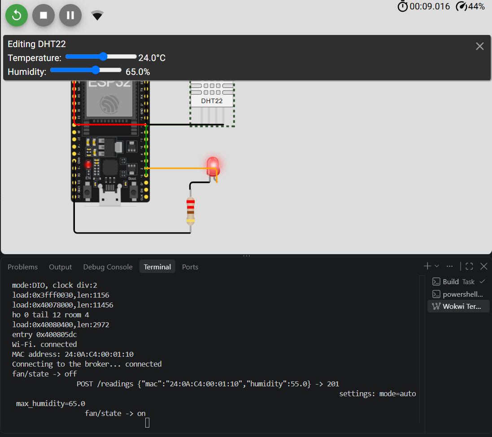
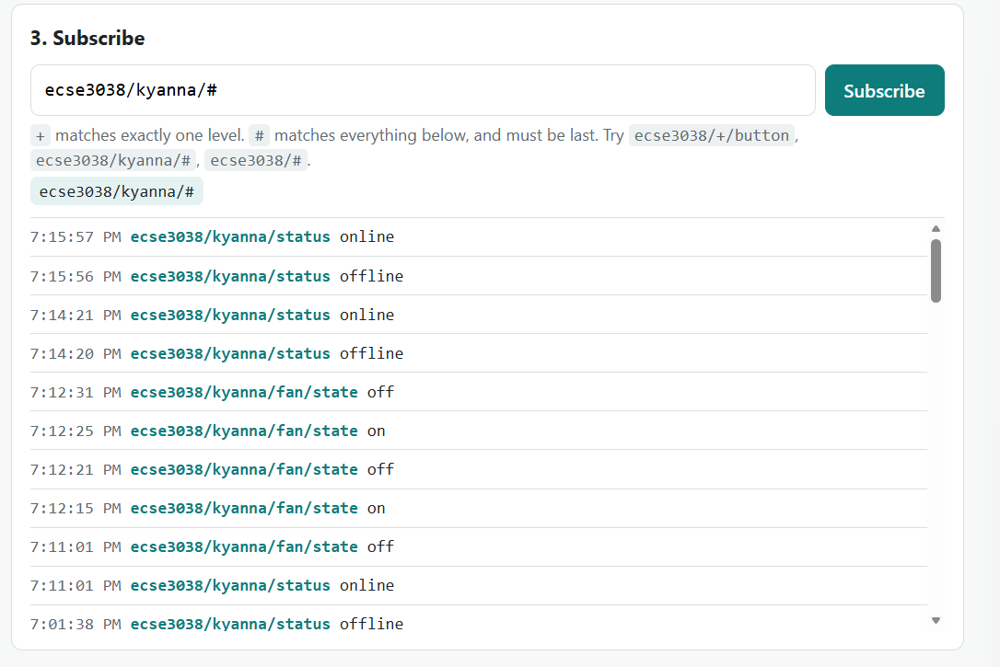

# ECSE3038 TEST 2: THE BATHROOM FAN

Kyanna Knight



An ESP32 (in Wokwi) with a DHT22 humidity sensor and an LED that stands for a bathroom extractor fan.
The board posts its humidity to a FastAPI + MongoDB Atlas API every 10 seconds. The fan's mode
(`auto`, `on`, `off`) and humidity limit are set on the API, which pushes them to the board over MQTT.

## REPOSITORY LAYOUT

- `api/` – the FastAPI app (`app.py`, `requirements.txt`). Its `.env` is never committed.
- `board/` – the PlatformIO project for the ESP32. `include/secrets.h` is never committed.

## API

| Route | What it does |
|---|---|
| `POST /fans` | Register a fan `{"mac", "room"}`; returns its key (201, 409 if the MAC exists) |
| `GET /fans`, `GET /fans/{mac}` | List fans / one fan, never showing keys (404 if unknown) |
| `POST /readings` | `{"mac", "humidity"}` with `X-API-Key` (401 / 403 / 422 / 201) |
| `GET /readings` | Newest first; optional `?mac=` and `?limit=` (1–100, default 10) |
| `PUT /fans/{mac}/settings` | `{"mode", "max_humidity"}`; stores them (201 new, 200 replaced) and publishes them retained on `ecse3038/<name>/fan/settings` |
| `DELETE /fans/{mac}` | Needs that fan's key in `X-API-Key` (204 / 401 / 403 / 404) |

## HOW TO RUN THE API (ON THE VM)

```bash
sudo systemctl stop iot-api
git clone https://github.com/kyanna07/ECSE3038-test2.git
cd ECSE3038-test2/api
python3 -m venv venv
source venv/bin/activate
python -m pip install -r requirements.txt
nano .env        # MONGODB_URI=<your Atlas string>  and  MQTT_NAME=<name>
uvicorn app:app --host 127.0.0.1 --port 8000
```

nginx forwards port 80 to port 8000, so the API is at `http://<vm-name>/docs`.
When finished: Ctrl+C, then `sudo systemctl start iot-api`.

## HOW TO RUN THE BOARD (WOKWI)

1. Open the `board` folder in VS Code with PlatformIO and the Wokwi extension installed.
2. Create `include/secrets.h` containing `#define DEVICE_KEY ""`.
3. Build (PlatformIO ✓), then **Wokwi: Start Simulator**. Copy the MAC from the Serial Monitor (the first POST returns 401).
4. `POST /fans` with that MAC, put the returned key between the quotes in `include/secrets.h`, rebuild and restart.
5. `PUT /fans/<mac>/settings` with `{"mode": "auto", "max_humidity": 65}`, then drag the DHT22's humidity above 65: the LED turns on.

## MQTT TOPICS

Class broker `135.232.203.144:1883`:

- `ecse3038/<name>/fan/settings` – written by the API, retained, JSON
- `ecse3038/<name>/fan/state` – written by the board, retained, `on` / `off`
- `ecse3038/<name>/status` – `online` from the board, `offline` as its last will, retained

The topics live on the class MQTT page (subscribed to `ecse3038/kyanna/#`): the fan switching on and off as the humidity crosses 65 %, and the status going `offline` / `online` as the board reconnects.


